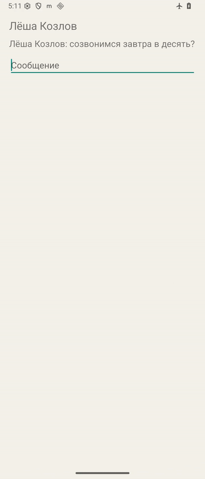

# Murmur

**100% offline voice dictation for Android — keep your keyboard.**

[Download Latest APK](https://github.com/freQuensy23-coder/murmur/releases/latest) · [Obtainium](https://apps.obtainium.imranr.dev/redirect?r=obtainium://add/https://github.com/freQuensy23-coder/murmur) · [По-русски](README.ru.md)

 

---

Tap a floating bubble in any app, speak naturally, and tap again — clean, punctuated text lands directly in the focused field. Speech recognition, optional screen-aware OCR, and fine-tuned LLM cleanup all run locally on your phone with zero cloud calls.

## Why Murmur

- **Keep your keyboard** — floats over Google Messages, Telegram, Slack, Gmail, Notes, or any other app without replacing Gboard or Samsung Keyboard.
- **100% offline** — ASR, VAD, optional OCR, and cleanup LLM all run on-device. Works in Airplane Mode; no account, no telemetry.
- **Smart LLM cleanup** — a fine-tuned local model strips filler words, fixes punctuation and casing, and polishes phrasing while preserving your meaning.
- **Screen-aware, RAM-only** — optional on-device OCR reads names and terms from the current screen into RAM only (never written to disk, never sent anywhere).
- **Swappable models & on-device benchmarks** — pick ASR and cleanup engines in the Model Hub and benchmark CPU vs. Qualcomm NPU directly on your phone.

## Install

Requires **Android 14+**.

- **Direct APK:** download the signed `release.apk` from [GitHub Releases](https://github.com/freQuensy23-coder/murmur/releases/latest).
- **Auto-updates:** add Murmur in [Obtainium](https://apps.obtainium.imranr.dev/redirect?r=obtainium://add/https://github.com/freQuensy23-coder/murmur).

**First run:**
1. Grant microphone, floating bubble (overlay), and accessibility permissions.
2. Download the default **Speech + Murmur Cleanup** pack on Wi-Fi (or choose **Speech only**).
3. Focus any text field and tap the floating `m` bubble to dictate.

## Inside the app

  

- **History** — replay saved audio clips, inspect raw vs. cleaned text, and retry with a different model.
- **Model Hub** — download, switch, and benchmark speech & cleanup models on your own hardware.
- **Settings** — control screen-context OCR scope, cleanup style, and trigger behavior.

## On-device stack

| Stage | Models / Runtime | Acceleration |
| --- | --- | --- |
| **Speech (ASR)** | Parakeet TDT 0.6B v3, GigaAM v3, Nemotron Streaming (ONNX / Sherpa) | CPU & Qualcomm NPU |
| **Voice Activity** | Silero VAD v5 | CPU |
| **Text Cleanup** | Fine-tuned Qwen3.5 / LFM (GGUF via `llama.cpp`) | CPU & Qualcomm NPU |
| **Screen OCR** *(optional)* | PP-OCRv5 / PP-OCRv6 (RAM-only) | CPU & Qualcomm NPU |

<strong>On-device benchmarks (Galaxy S25 Ultra)</strong>

 

- End-to-end stop-to-insert latency with cleanup enabled: **~815 ms** on Galaxy S25 Ultra.
- Standalone screen OCR (median of 7 warm runs, Qualcomm NPU without CPU fallback):
  - Detection: **2.79 ms** NPU vs. **34.40 ms** CPU
  - Recognition: **3.15 ms** NPU vs. **12.41 ms** CPU

  

## Documentation & Building

- [Architecture & pipeline](docs/ARCHITECTURE.md)
- [Build from source](docs/dev/BUILD.md)
- [Model catalog](core/catalog/src/main/resources/catalog/catalog.json)

## License

[Apache-2.0](LICENSE) · [Third-party notices](THIRD_PARTY_NOTICES.md). Downloadable models retain their respective licenses.
