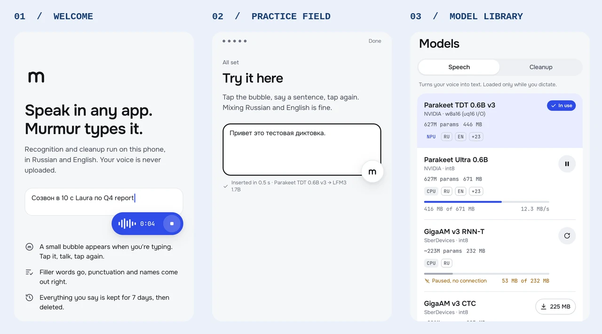
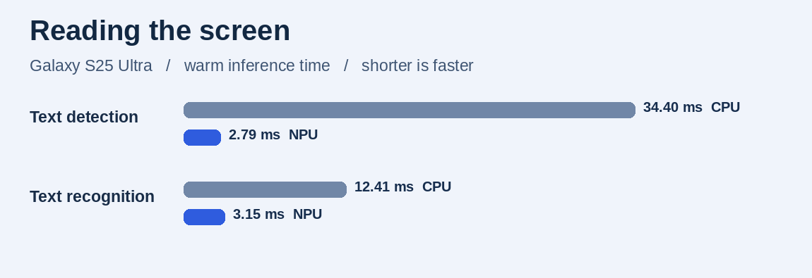

# Murmur

[По-русски](README.ru.md) · [Download v0.2.1 APK](https://github.com/freQuensy23-coder/murmur/releases/download/v0.2.1/murmur-v0.2.1-release.apk) · [All Releases](https://github.com/freQuensy23-coder/murmur/releases) · [Auto-updates via Obtainium](https://apps.obtainium.imranr.dev/redirect?r=obtainium://add/https://github.com/freQuensy23-coder/murmur)

**Open-source, 100% offline voice dictation for Android 14+ — keep your usual keyboard.** Tap Murmur’s floating bubble, dictate a reply, then tap again. Your words appear directly in the focused field. Speech recognition, optional screen-aware OCR, and fine-tuned LLM cleanup all run on the phone with no internet connection.

  

## Try it on your phone

Install the signed [v0.2.1 release APK](https://github.com/freQuensy23-coder/murmur/releases/tag/v0.2.1) (or add the repo to [Obtainium](https://apps.obtainium.imranr.dev/redirect?r=obtainium://add/https://github.com/freQuensy23-coder/murmur)) on **Android 14 or newer**. Follow the setup prompts for the microphone, floating bubble and accessibility service, download the default **Speech + Murmur Cleanup** pack on Wi-Fi, then try a sentence in the practice field before switching to a messaging app.

Screen context (RAM-only OCR) and dictated audio are processed entirely on the device. You can also switch to **Speech only** or pick any other speech/cleanup model in the Model Hub.

## Inside the app

*Android emulator captures with sample data. Open a full screen: [Welcome](docs/readme/welcome.webp) · [Practice](docs/readme/practice.webp) · [Models](docs/readme/models.webp).*

**History** lets you replay a saved recording and retry a dictation. **Models** lets you download engines and compare their speed on your own phone. **Settings** is where you choose what screen context cleanup can use.

## What has actually run on a phone?

On a **Galaxy S25 Ultra**, Murmur transcribed a prerecorded Russian sentence with no word errors, read nine words from the screen, and inserted the result into another app’s test field with Samsung Keyboard. With optional cleanup on, the field updated **815 ms after stop** in that run. The test used software start/stop and prerecorded audio; it does not establish microphone quality, bubble usability or Fold7 behavior.

*Separate OCR benchmark, not whole-dictation latency: median of seven warm runs per engine on the same input. The Qualcomm accelerator ran without CPU fallback.*

[How the pipeline works](docs/ARCHITECTURE.md) · [Build from source](docs/dev/BUILD.md) · [Model catalog](core/catalog/src/main/resources/catalog/catalog.json) · [Physical-device checklist](docs/DEVICE_CHECKLIST.md)

[Apache-2.0](LICENSE) · [Third-party notices](THIRD_PARTY_NOTICES.md). Downloadable models retain their own licenses.
