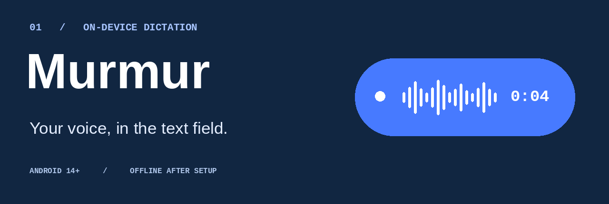
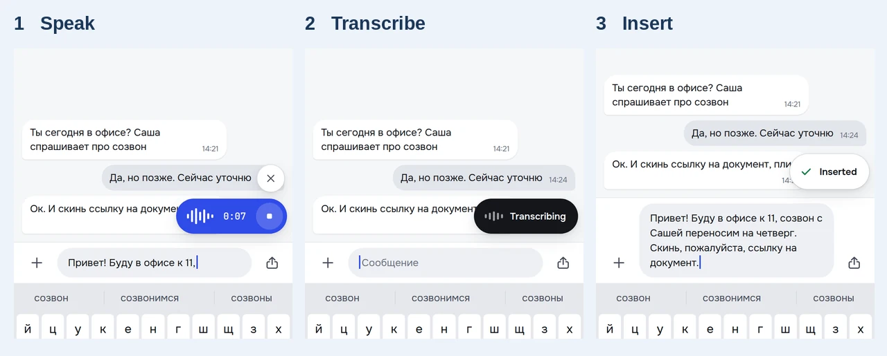

# Murmur

[English](README.md) · [Скачать тестовый APK](https://github.com/freQuensy23-coder/murmur/releases/download/test-56e9d4b/murmur-56e9d4b-speech-first.apk) · [О сборке](https://github.com/freQuensy23-coder/murmur/releases/tag/test-56e9d4b)

**Поставьте курсор туда, где нужен текст.** Нажмите плавающую кнопку Murmur, надиктуйте ответ и нажмите ещё раз. Слова появятся в том же поле. Менять клавиатуру не нужно. После загрузки моделей диктовка работает без интернета.

*Так работает кнопка диктовки. Иллюстрация из прототипа интерфейса.*

## Попробовать на телефоне

Установите [тестовую сборку](https://github.com/freQuensy23-coder/murmur/releases/tag/test-56e9d4b) на **Android 14 или новее**. При настройке разрешите доступ к микрофону, показ плавающей кнопки и работу службы специальных возможностей для вставки текста. Выберите **Speech only**, скачайте модели по Wi-Fi и надиктуйте фразу в тренировочное поле. Затем попробуйте в мессенджере.

По умолчанию Murmur вставляет текст в том виде, в каком его распознал. По желанию можно включить локальную модель для расстановки знаков препинания и уточнения слов по контексту экрана. **Автоправка экспериментальная:** иногда она меняет или пропускает сказанное. Звук и содержимое экрана обрабатываются на телефоне.

## Как выглядит приложение

*Снимки с эмулятора Android с тестовыми данными. Открыть целиком: [приветствие](docs/readme/welcome.webp) · [пробная диктовка](docs/readme/practice.webp) · [выбор модели](docs/readme/models.webp).*

В **истории** можно прослушать сохранённую запись и повторить распознавание. В **библиотеке моделей** — скачать движок и измерить его скорость на своём телефоне. В **настройках** — выбрать, какую информацию с экрана разрешено использовать для автоправки.

## Что проверили на реальном телефоне

На **Galaxy S25 Ultra** Murmur без ошибок распознал тестовую запись на русском, прочитал девять слов с экрана и через Samsung Keyboard вставил результат в поле другого приложения. С включённой автоправкой текст появился через **815 мс после остановки**. В этом прогоне запись подавалась из файла, а старт и остановка выполнялись программно. Микрофон, нажатие плавающей кнопки и поведение Fold7 при складывании ещё предстоит проверить.

*График показывает только чтение текста с экрана. Для каждого движка взята медиана семи повторов после прогрева на одинаковых данных. Ускоритель Qualcomm работал без подмены вычислений на CPU.*

[Как устроена диктовка](docs/ARCHITECTURE.md) · [Сборка из исходников](docs/dev/BUILD.md) · [Каталог моделей](core/catalog/src/main/resources/catalog/catalog.json) · [Проверки на телефоне](docs/DEVICE_CHECKLIST.md)

[Лицензия Apache-2.0](LICENSE) · [Сторонние компоненты](THIRD_PARTY_NOTICES.md). У скачиваемых моделей свои лицензии.
