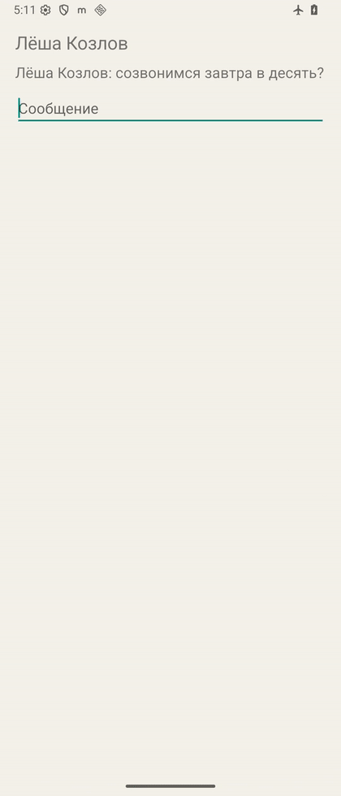
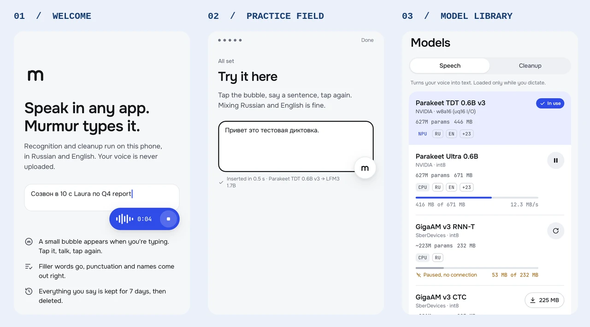
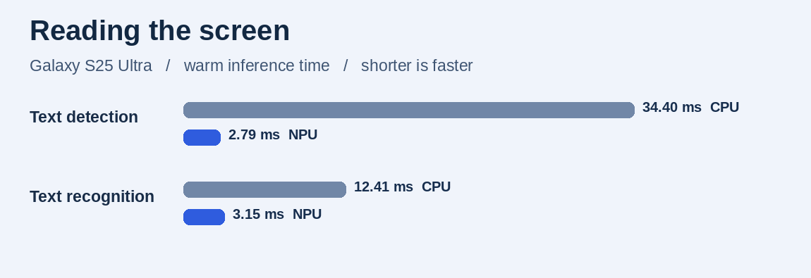

# Murmur

[English](README.md) · [Скачать v0.2.1 APK](https://github.com/freQuensy23-coder/murmur/releases/download/v0.2.1/murmur-v0.2.1-release.apk) · [Все релизы](https://github.com/freQuensy23-coder/murmur/releases) · [Автообновления через Obtainium](https://apps.obtainium.imranr.dev/redirect?r=obtainium://add/https://github.com/freQuensy23-coder/murmur)

**Открытая 100% офлайн-диктовка для Android 14+ — без замены вашей клавиатуры.** Нажмите плавающую кнопку Murmur, надиктуйте ответ и нажмите ещё раз — чистый текст вставится прямо в поле ввода. Распознавание речи, локальный OCR экрана и дообученная LLM-автоправка работают на самом телефоне без интернета.

  

## Попробовать на телефоне

Установите подписанный [релиз v0.2.1](https://github.com/freQuensy23-coder/murmur/releases/tag/v0.2.1) (или добавьте репозиторий в [Obtainium](https://apps.obtainium.imranr.dev/redirect?r=obtainium://add/https://github.com/freQuensy23-coder/murmur)) на **Android 14 или новее**. Разрешите доступ к микрофону, показ плавающей кнопки и службу специальных возможностей, скачайте пакет **Speech + Murmur Cleanup** по Wi-Fi и проверьте в тренировочном поле.

Звук и контекст экрана (OCR хранится только в оперативной памяти) обрабатываются локально на устройстве. В хабе моделей можно выбрать любой движок распознавания или отключить автоправку (**Speech only**).

## Как выглядит приложение

*Снимки с эмулятора Android с тестовыми данными. Открыть целиком: [приветствие](docs/readme/welcome.webp) · [пробная диктовка](docs/readme/practice.webp) · [выбор модели](docs/readme/models.webp).*

В **истории** можно прослушать сохранённую запись и повторить распознавание. В **библиотеке моделей** — скачать движок и измерить его скорость на своём телефоне. В **настройках** — выбрать, какую информацию с экрана разрешено использовать для автоправки.

## Что проверили на реальном телефоне

На **Galaxy S25 Ultra** Murmur без ошибок распознал тестовую запись на русском, прочитал девять слов с экрана и через Samsung Keyboard вставил результат в поле другого приложения. С включённой автоправкой текст появился через **815 мс после остановки**. В этом прогоне запись подавалась из файла, а старт и остановка выполнялись программно. Микрофон, нажатие плавающей кнопки и поведение Fold7 при складывании ещё предстоит проверить.

*График показывает только чтение текста с экрана. Для каждого движка взята медиана семи повторов после прогрева на одинаковых данных. Ускоритель Qualcomm работал без подмены вычислений на CPU.*

[Как устроена диктовка](docs/ARCHITECTURE.md) · [Сборка из исходников](docs/dev/BUILD.md) · [Каталог моделей](core/catalog/src/main/resources/catalog/catalog.json) · [Проверки на телефоне](docs/DEVICE_CHECKLIST.md)

[Лицензия Apache-2.0](LICENSE) · [Сторонние компоненты](THIRD_PARTY_NOTICES.md). У скачиваемых моделей свои лицензии.
